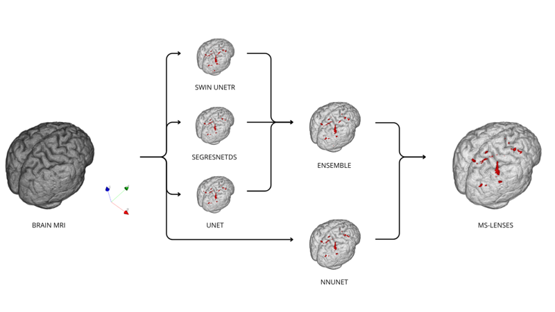
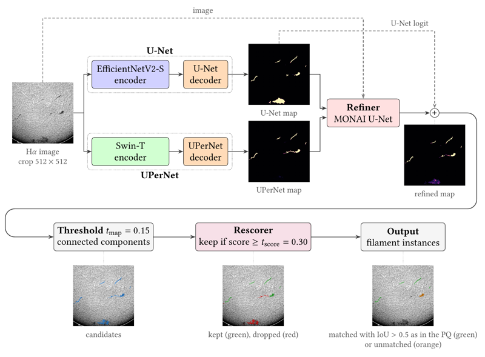
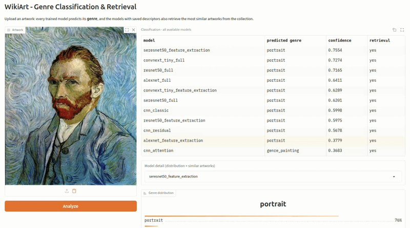

# Hi, I'm Francesco 👋

I'm currently doing my **MSc in Computer Science** at the **University of Cagliari**, in the *Applied Artificial Intelligence* track, where I'm working on deep learning, NLP, information retrieval and reinforcement learning.

Before that I graduated with a **BSc in Applied Computer Science and Data Analytics** (*Informatica Applicata e Data Analytics*), also at UniCa, focused on machine learning, deep learning, big data and statistics. For my thesis I built [MS-LENSES](https://github.com/ChiccoSechi/MS-LENSES), a pipeline for Multiple Sclerosis lesion segmentation on MRI.

## 🔍 Interests

- Machine learning and deep learning
- Computer vision and image segmentation
- AI for healthcare and medical imaging
- LLMs, RAG and NLP

## 🛠️ Projects

*You can also find my main projects pinned below.*

### Computer Vision

<table>
  <tr>
    <td width="40%"></td>
    <td width="60%">
      <h3><a href="https://github.com/ChiccoSechi/MS-LENSES">MS-LENSES</a></h3>
      
My Bachelor's thesis. Multiple Sclerosis lesion segmentation on 3D FLAIR MRI, with an ensemble of MONAI and nnUNet models and FLAIR-adaptive postprocessing.

      
<code>PyTorch</code> <code>MONAI</code> <code>nnUNet</code> <code>Medical imaging</code>

    </td>
  </tr>
  <tr>
    <td width="40%"></td>
    <td width="60%">
      <h3><a href="https://github.com/ChiccoSechi/solar-filament-segmentation-challenge">Solar Filament Segmentation</a></h3>
      
U-Net + UPerNet with a refiner and rescorer to segment solar filaments, built for a 2026 Kaggle challenge.

      
<code>PyTorch</code> <code>U-Net</code> <code>UPerNet</code> <code>Kaggle</code>

    </td>
  </tr>
  <tr>
    <td width="40%"></td>
    <td width="60%">
      <h3><a href="https://github.com/ChiccoSechi/WikiArt">WikiArt</a></h3>
      
Artwork genre classification and image retrieval with custom CNNs and pretrained models (AlexNet, ResNet50, SEResNet50, ConvNeXt-Tiny), with a Gradio demo.

      
<code>PyTorch</code> <code>CNN</code> <code>Image retrieval</code> <code>Gradio</code>

    </td>
  </tr>
</table>

### LLMs and RAG
- [unirag](https://github.com/ChiccoSechi/unirag): RAG over the UniCa CS Master's degree pages, with a crawler, Cloudflare (Workers AI, Vectorize, D1) and a Telegram bot.

### Others
- [SmartFarm](https://github.com/ChiccoSechi/SmartFarm): IoT pipeline with MQTT, Telegraf, InfluxDB, MongoDB and Grafana, in Docker Compose.
- [sequence-alignment](https://github.com/ChiccoSechi/sequence-alignment): interactive visualizer for Needleman-Wunsch, Smith-Waterman and FASTA.
- [Frogger-Game](https://github.com/ChiccoSechi/Frogger-Game): Frogger-like game in C for Linux, one version with processes and one with threads.
